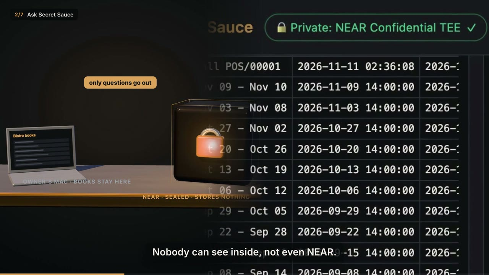
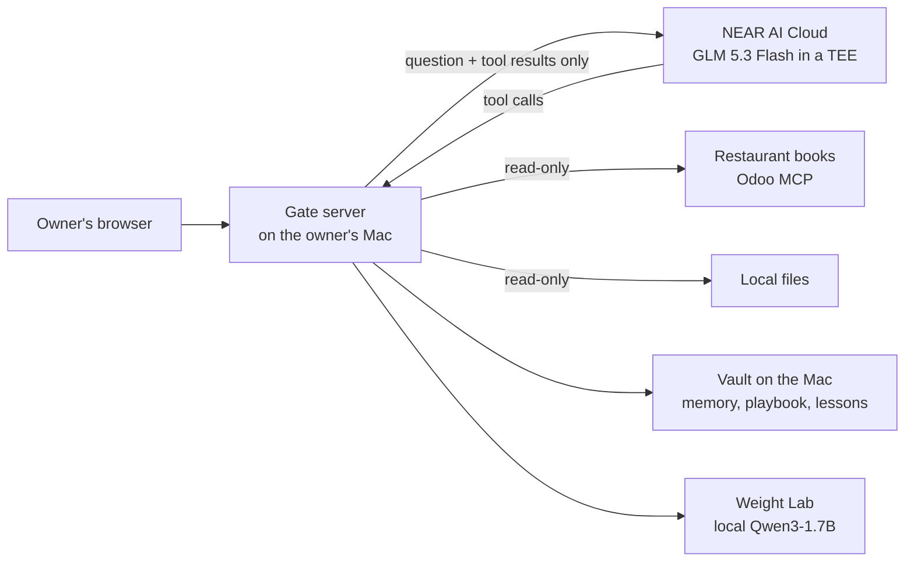

# Secret Sauce

A private AI analyst for small restaurants. The owner chats with their own books. A sealed model on NEAR AI Cloud does the thinking, the books stay on the owner's Mac, and NEAR slowly teaches a small local model to do the job itself.

Built at the NEAR Private AI Hackathon NYC, Nov 11 2026. Track: Privacy & Private AI.

[](docs/media/secret-sauce-demo.mp4)

**[Watch the 1-minute demo (mp4, 59 s)](docs/media/secret-sauce-demo.mp4)**

## The problem

A restaurant's books hold sales, cash counts, unpaid bills, staff and pay. An owner can't paste that into a public chatbot. A local model is private, but it's too weak to find real problems on its own.

## How it works



1. **Ask.** The owner asks a question in a local chat page.
2. **NEAR reads through tools.** NEAR's sealed model can't see the books. It asks the gate to run read-only tools, such as `get_cash_differences`. The gate runs each tool on the Mac and sends back only the rows that tool returned.
3. **Answer with numbers.** In the demo data, NEAR found $480 of cash-drawer shortages, growing every week since Oct 6. It also found a $21,700 payroll bill sent by a food wholesaler.
4. **Remember.** NEAR is stateless, so the gate puts a memory file and a house playbook from the local vault into every prompt. NEAR can propose new memory notes and rules. Nothing is saved until the owner clicks Approve.
5. **Teach the local model.** "Teach from this chat" runs one lap:
   - NEAR turns the answer into lessons plus a held-out exam question.
   - The Mac tests the local Qwen3-1.7B student.
   - The Mac edits one layer of the student's weights: a rank-one edit to the MLP `down_proj`.
   - The Mac tests the student again.
   - If the score drops, the edit is undone.

   NEAR never touches the weights. It only calls the lab's tools.
6. **Graduate (the plan).** Once the local model passes its exams, the owner runs it alone. NEAR becomes a monthly tutor: it writes new exams and lessons.

## What's sealed and what isn't

| Part | Where it runs | Notes |
|---|---|---|
| The model that reasons over the data | NEAR AI Cloud, GLM 5.3 Flash, listed as Confidential TEE | The model sees only the question and what each tool returned. The app shows an attestation badge. |
| The books, the vault, lessons, weight edits | The owner's Mac | `vault/` is git-ignored. Lessons and edited weights are as private as the data itself. |
| Tool access | The gate on the Mac | Read-only. File tools are locked to one folder and refuse `.env` and agent config. |

Limits we know about: a TEE protects data while NEAR uses it, but it doesn't make the model correct. The local model is small. One weight edit rarely fixes a full answer.

## Results so far (real runs on the demo data)

| Lap | Exam before | Exam after | Outcome |
|---|---|---|---|
| 1 | 0.357 | 0.357 | kept, no change |
| 2 | 0.24 | 0.35 | kept |
| 3 | 0.309 | 0.132 | undone automatically |

The exam score is word overlap plus number match against NEAR's answer, on held-out questions. These laps show that the loop works and that it guards itself. They don't prove the student has graduated.

## Try it (Apple Silicon Mac, Python 3.12)

1. Install:
   ```bash
   python3.12 -m venv .venv && .venv/bin/pip install -r requirements.txt
   cp .env.example .env    # add your NEAR AI Cloud key; never commit .env
   ```
2. Start the app from the repo folder:
   ```bash
   SAUCE_ROOT=$PWD .venv/bin/python apps/secret-sauce-web/server.py
   ```
   Open http://localhost:8790. You should see the chat, a "Private: NEAR Confidential TEE" badge, and a Training pane.
3. Click **"Is anyone stealing from the cash drawer?"**
   - The left pane fills with each tool call and the rows it returned.
   - The answer cites the weekly shortages.
   - This takes 15 s to 2 min, depending on NEAR's load.
4. Click **Teach from this chat**.
   - The right pane lights up 6 steps: lessons, held-out exam, exam before, weight edit (layer and change size), exam after, keep or undo.
   - The first lap downloads Qwen3-1.7B (about 3.4 GB).
5. Without the bistro data: leave `BISTRO_MCP_*` empty. The app still runs on local files in `vault/owner-files` (or `SAUCE_DATA_DIR`). The demo restaurant's Odoo server is run by a teammate, and its address rotates.

## Repository layout

| Path | What it is |
|---|---|
| `apps/secret-sauce-web/` | Chat page plus gate server (Starlette). NEAR tool loop, read-only tools, memory approvals, Training pane. |
| `apps/weight-lab/` | Local MCP server that edits and tests the student model with MLX. It also has a LoRA fallback. |
| `apps/character-guide/` | Teammate's walkthrough-character UI prototype (React/Vite). |
| `Restaurant-MCP_GUIDE.md` | How to connect to the demo restaurant's read-only Odoo MCP. |
| `HACKATHON.md` | The event's rules for coding agents. |
| `docs/media/` | Demo video and poster. |

## NEAR features used

- **NEAR AI Cloud private inference:** GLM 5.3 Flash in a Confidential TEE, through the OpenAI-compatible API with tool calling.
- **Planned, not built yet:**
  - a NEAR smart contract that records a "graduation diploma": the model's hash plus its exam scores, with no restaurant data on-chain
  - vendor bill payments through NEAR Intents, quote first, sent only after the owner approves

## Built with

Python (Starlette, uvicorn, MCP SDK, MLX, mlx-lm), Qwen3-1.7B (Apache-2.0), OpenCode for early analysis runs, and React/Vite for the character prototype. The demo restaurant is simulated Odoo data, not a real business. Code was written with AI coding agents during the event.

## Team

Luis Escobar ([@Escobar-Luis](https://github.com/Escobar-Luis)), Bondan Herumurti ([@bherumurti](https://github.com/bherumurti)), [@adamaslan](https://github.com/adamaslan).

## License

[MIT](LICENSE)
